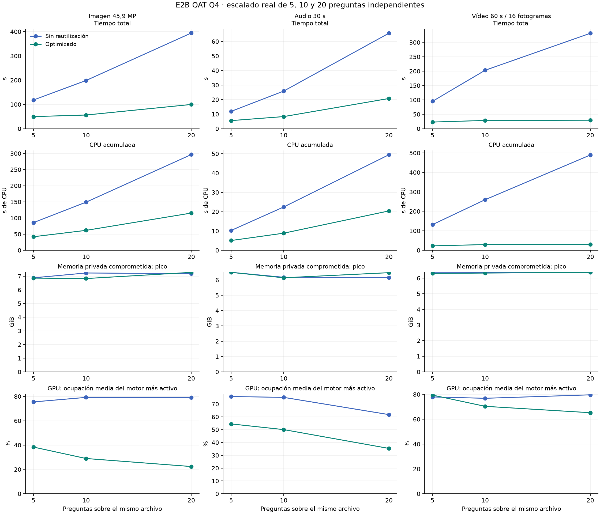

# E2B: 5, 10 y 20 preguntas sobre el mismo archivo

> Medición local del 17 de octubre de 2026. Intel Core Ultra 9 285H,
> 16 procesadores lógicos, 64 GB de RAM e Intel Arc 140T integrada, Vulkan.
> El informe resume una ejecución histórica. Los registros originales completos
> permanecen locales; no se publican cargas, rutas privadas ni datos de proceso.




Prueba real de la versión optimizada frente al mismo adaptador con reutilización desactivada. Una pasada completa por cada archivo, tamaño y modo; los valores no son extrapolaciones ni medianas. Se añadieron calentamientos separados y una repetición de 20 preguntas en orden inverso por archivo.

Se completaron 279 inferencias: 210 en la matriz principal, 60 para comprobar el orden inverso y 9 de calentamiento. Las pruebas adicionales de límite de contexto se hicieron después y no forman parte de los tiempos de rendimiento.

## Tiempo total y recursos

Cada celda muestra sin reutilización → optimizado. El tiempo incluye una carga del archivo, todos los conteos externos, inferencias secuenciales con su propio conteo interno y retirada de la copia.

| Archivo | Preguntas | Tiempo total (s) | CPU media (%) | CPU acumulada (s) | RAM residente pico (GiB) | Compromiso privado pico (GiB) | GPU media (%) | RAM compartida GPU pico (GiB) |
|---|---:|---:|---:|---:|---:|---:|---:|---:|
| Imagen 45,9 MP | 5 | 118,13 → 49,72 | 4,5 → 5,3 | 85,64 → 41,91 | 6,42 → 6,40 | 6,88 → 6,86 | 75,5 → 38,4 | 3,43 → 3,43 |
| Imagen 45,9 MP | 10 | 198,65 → 56,19 | 4,7 → 6,9 | 149,03 → 61,66 | 1,62 → 1,21 | 7,23 → 6,83 | 79,2 → 29,0 | 3,43 → 3,43 |
| Imagen 45,9 MP | 20 | 394,36 → 99,73 | 4,7 → 7,2 | 296,53 → 115,25 | 1,55 → 1,60 | 7,18 → 7,28 | 79,2 → 22,4 | 3,43 → 3,43 |
| Audio 30 s | 5 | 11,89 → 5,54 | 5,4 → 5,7 | 10,25 → 5,05 | 0,86 → 0,85 | 6,50 → 6,50 | 75,8 → 54,5 | 3,43 → 3,43 |
| Audio 30 s | 10 | 25,86 → 8,30 | 5,4 → 6,7 | 22,42 → 8,84 | 0,56 → 0,53 | 6,17 → 6,14 | 75,2 → 50,0 | 3,43 → 3,43 |
| Audio 30 s | 20 | 65,67 → 20,75 | 4,7 → 6,1 | 49,48 → 20,38 | 5,71 → 6,02 | 6,15 → 6,47 | 61,7 → 35,4 | 3,43 → 3,43 |
| Vídeo 60 s / 16 fotogramas | 5 | 95,07 → 22,92 | 8,7 → 6,2 | 131,75 → 22,62 | 1,30 → 1,26 | 6,34 → 6,30 | 77,9 → 79,4 | 3,43 → 3,43 |
| Vídeo 60 s / 16 fotogramas | 10 | 203,05 → 28,52 | 8,0 → 6,4 | 259,72 → 29,16 | 5,86 → 1,28 | 6,35 → 6,32 | 76,8 → 70,4 | 3,43 → 3,43 |
| Vídeo 60 s / 16 fotogramas | 20 | 331,68 → 29,36 | 9,2 → 6,3 | 489,50 → 29,58 | 0,74 → 0,72 | 6,38 → 6,37 | 79,6 → 65,2 | 3,43 → 3,43 |

## Detalle del modo optimizado

| Archivo | Preguntas | Primera respuesta (s) | Total por pregunta (s) | Inferencias posteriores, mediana (s) | Preguntas/minuto | Entrada por pregunta (tokens) | Suma de entradas (tokens) | Ahorro de tiempo (%) |
|---|---:|---:|---:|---:|---:|---|---:|---:|
| Imagen 45,9 MP | 5 | 30,28 | 9,94 | 4,43 | 6,0 | 1141–1157 | 5735 | 57,9 |
| Imagen 45,9 MP | 10 | 28,46 | 5,62 | 3,08 | 10,7 | 1141–1157 | 11477 | 71,7 |
| Imagen 45,9 MP | 20 | 42,95 | 4,99 | 2,93 | 12,0 | 1141–1160 | 22974 | 74,7 |
| Audio 30 s | 5 | 3,24 | 1,11 | 0,57 | 54,2 | 815–823 | 4094 | 53,4 |
| Audio 30 s | 10 | 3,15 | 0,83 | 0,56 | 72,3 | 815–830 | 8211 | 67,9 |
| Audio 30 s | 20 | 7,01 | 1,04 | 0,72 | 57,8 | 813–830 | 16401 | 68,4 |
| Vídeo 60 s / 16 fotogramas | 5 | 20,08 | 4,58 | 0,71 | 13,1 | 1758–1776 | 8827 | 75,9 |
| Vídeo 60 s / 16 fotogramas | 10 | 21,53 | 2,85 | 0,74 | 21,0 | 1757–1776 | 17636 | 86,0 |
| Vídeo 60 s / 16 fotogramas | 20 | 17,59 | 1,47 | 0,57 | 40,9 | 1757–1776 | 35284 | 91,1 |

La media total por pregunta incluye carga, conteos y primera inferencia. La mediana de inferencias posteriores excluye esos pasos iniciales y describe las preguntas 2…N. La primera respuesta puede tardar más al aumentar N, porque el flujo comprueba todos los presupuestos antes de empezar a inferir.

## Probabilidades independientes

Verificación: CORRECTA, 27 comprobaciones. Se contrastaron 105 parejas optimizado/sin reutilización, 45 comparaciones entre tamaños y 60 preguntas en orden inverso contra su control sin caché. Máxima diferencia absoluta entre probabilidades: 0,000000 puntos porcentuales.
Cada pregunta tiene su propia consulta, entre dos y cuatro opciones en esta prueba, vector finito normalizado y salida de una etiqueta. Se variaron las posiciones de las opciones. El banco contiene 20 preguntas distintas por archivo, incluidas preguntas relacionadas entre sí. No se incluyeron otras preguntas ni respuestas en el prompt de cada petición. Las probabilidades permanecen sin calibrar; esta prueba no mide precisión semántica con etiquetas humanas.

## Límite de 4096 tokens

Cada respuesta se reservó un token. Todos los conteos externos coincidieron con el consumo nativo y con el conteo interno previo a inferir. La reutilización no descuenta tokens del presupuesto: se cuentan también los tokens del prefijo reutilizado.
En los tres tipos de archivo se buscó y ejecutó una petición de exactamente 4095 tokens de entrada + 1 de salida, aceptada con total 4096. Una entrada de 4096 + 1 de salida se rechazó con HTTP 422; el registro del motor confirmó que no arrancó inferencia para ella. Después de cada rechazo se ejecutó una pregunta válida correspondiente a los grupos de 5, 10 y 20. Los nueve controles se conservaron en budget-controls.json.
La suma de los presupuestos de preguntas distintas no constituye un único contexto. Los grupos de 10 y 20 superan 4096 tokens sumados y funcionan porque cada pregunta cabe individualmente.

## Protocolo y alcance

- Mismos archivos públicos: foto de los Alpes de 10.109 × 4.542 píxeles, voz en español de 30 segundos y vídeo de Marsella de 60 segundos a 16 fotogramas; el vídeo se evalúa sin su pista de audio. Procedencia y licencias: [ATTRIBUTION.md](ATTRIBUTION.md).
- Ambas variantes suben una copia por grupo. El control usa reuse_media=false y cache_prompt=false siempre. El optimizado usa reuse_media=true, empieza con cache_prompt=false y habilita la reutilización nativa a partir de la segunda pregunta. Cada grupo empieza sin ventaja de la inferencia anterior.
- Orden alternado entre modos; tamaños distribuidos entre modalidades para reducir la influencia de la deriva temporal. La repetición en orden inverso se informa como auditoría de independencia, no se mezcla con la pasada principal.
- Modelo ya cargado. No se vació la caché de disco del sistema operativo. No se cambió el adaptador, el modelo ni su configuración durante la prueba.
- CPU: usuario + kernel del servicio y sus descendientes, incluso procesos de conversión terminados, más backend y cliente/monitor. Porcentaje normalizado sobre 16 procesadores lógicos. Los segundos de CPU expresan trabajo acumulado; su porcentaje puede subir durante una ejecución más breve.
- RAM residente es la suma de working sets. El compromiso privado puede estar respaldado por RAM o paginación. No se trata de memoria incremental respecto al reposo. La GPU integrada comparte RAM: no sumar sus GiB como memoria independiente.
- GPU: contador PDH por PID del motor más activo, ponderado por tiempo, y pico de memoria compartida. No mide vatios ni energía. E4B permaneció cargado e inactivo; sus procesos se excluyen del consumo atribuido.
- Muestreo solicitado cada 0,1 s; intervalo real mediano 0,188 s, máximo 0,926 s. Otras aplicaciones siguieron activas.
- Una pasada emparejada por tamaño: estos valores describen esta sesión y no establecen significación estadística. Cada punto de la curva se midió por completo.

plan.json conserva preguntas, opciones, hashes y protocolo; source/ archiva las fuentes medidas; results.json incluye cada respuesta; samples.jsonl, el muestreo; verification.json, las comprobaciones; workflows.csv y questions.csv permiten analizar los datos.

## Repetir con un checkout nuevo

Con E2B instalado y en marcha, desde la raíz del proyecto:

```powershell
python -m pip install -e ".[evaluation,benchmark]"
python scripts/prepare_real_multimodal_benchmark.py
python scripts/benchmark_e2b_scaling.py --output inference/e2b-scaling-public
python scripts/validate_e2b_scaling_budget.py --output inference/e2b-scaling-public
python scripts/summarize_e2b_scaling.py --output inference/e2b-scaling-public
```

La preparación descarga medios públicos de Wikimedia Commons y genera los
recortes atribuidos en `inference/real-media-benchmark-20261017/`. Descarga y
conversión no forman parte de los tiempos de inferencia. Puede tardar y consumir
varios cientos de MB de disco. Cada medición exige un directorio de salida nuevo;
no sobrescribas una medición previa.

`scaling-cases.json` fija las tres entradas y sus tres primeras preguntas;
`scripts/e2b_scaling_questions.py` las amplía a veinte por archivo. Los hashes del
manifiesto son los de los archivos de esta sesión histórica. Una compilación
FFmpeg distinta puede producir bytes diferentes: el nuevo plan registra el hash y
tamaño reales junto con los de referencia, y comprueba que los archivos permanezcan
inmutables durante la medición. Compara los manifiestos antes de atribuir cambios
exclusivamente al modelo o a la optimización.

Los scripts de publicación se han hecho independientes de planes generados en
experimentos anteriores. No se ha repetido la medición pesada al preparar el
repositorio; la tabla anterior sigue siendo la medición histórica. Una ejecución
nueva produce sus propios resultados, controles, gráficas e informes locales.

Los controles de límite hacen inferencias adicionales fuera de los intervalos de
rendimiento y necesitan que el servicio siga vivo. La verificación comprueba
identidad de procesos, hashes, subidas retiradas y salud del servicio; ejecútala
antes de pararlo. La prueba mide conservación de puntajes y consumo de recursos,
no acierto frente a etiquetas humanas.
